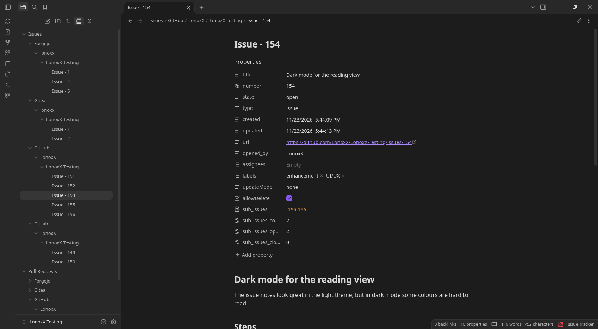
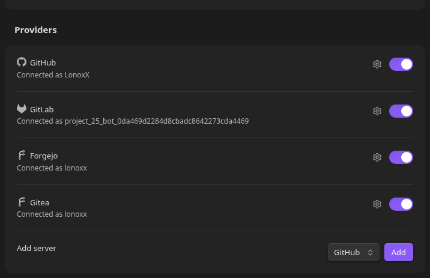
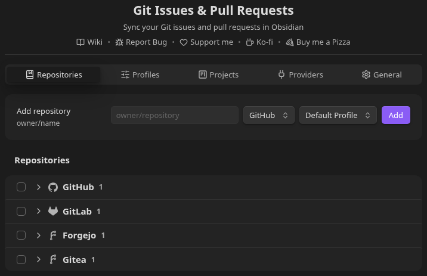
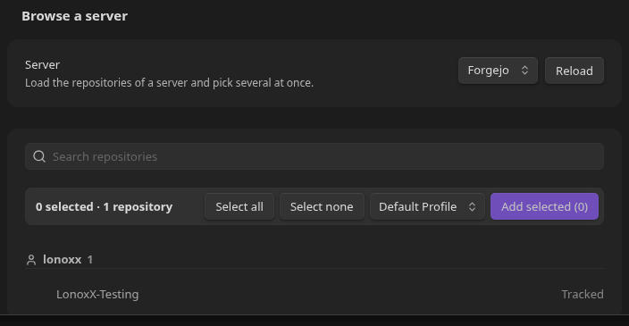
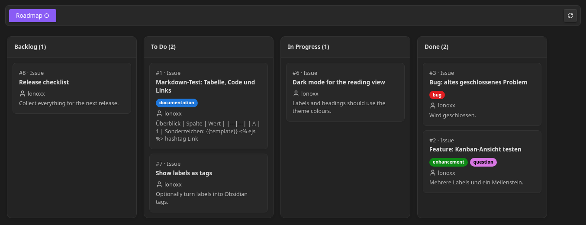
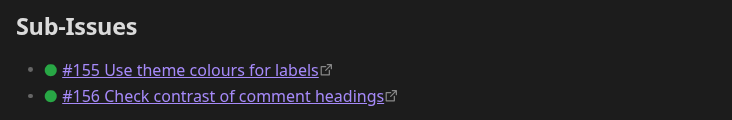

<h1>Git Issues & Pull Requests</h1>

Sync your Git issues and pull requests in Obsidian

<a href="https://github.com/LonoxX/obsidian-github-issues/wiki"> Wiki</a> · <a href="https://github.com/LonoxX/obsidian-github-issues/issues/new"> Report Bug</a> · <a href="https://github.com/sponsors/LonoxX"> Support me</a> · <a href="https://ko-fi.com/lonoxx"> Ko-fi</a> · <a href="https://buymeacoffee.com/lonoxx"> Buy me a Pizza</a>

## Providers

| Provider                   | Issues | Pull / Merge Requests | Sub-issues | Projects |
| -------------------------- | :----: | :-------------------: | :--------: | :------: |
| GitHub                     |   ✓    |           ✓           |     ✓      |    ✓     |
| GitLab (incl. self-hosted) |   ✓    |           ✓           |     ✓      |    ✓     |
| Gitea                      |   ✓    |           ✓           |     –      |    ✓     |
| Forgejo (incl. Codeberg)   |   ✓    |           ✓           |     –      |    –     |

On GitLab, projects are issue boards. Forgejo has project boards on its website, but does not offer them through its API yet.

## Installation

### Community plugins (recommended)

1. Open Obsidian Settings - **Community plugins**
2. Click **Browse** and search for "Git Issues & Pull Requests"
3. Click **Install**, then **Enable**

### Manual

1. Download the latest release from [GitHub Releases](https://github.com/LonoxX/obsidian-github-issues/releases)
2. Extract it to `<vault>/.obsidian/plugins/github-issues/`
3. Reload Obsidian and enable the plugin under **Community plugins**

## Getting started

1. **Setup assistant:** On the first start a short assistant connects your first server and adds a repository. You can open it again any time with the command **Open setup assistant**.
2. **Connect more servers:** In the **Providers** tab pick a type under **Add server** and paste a read-only token, see [Tokens](#tokens).
3. **Add repositories:** In the **Repositories** tab enter `owner/repo` under **Add repository**, or load a server under **Browse a server** and tick several repositories at once.
4. **Sync:** Click the sync icon in the ribbon or run **Sync all issues & pull requests**.

## Tokens

The plugin only reads from your servers and never changes anything there, so a token with read access is all it needs.

| Provider        | Where                                                                        | Scopes                                                                                                       |
| --------------- | ---------------------------------------------------------------------------- | ------------------------------------------------------------------------------------------------------------ |
| GitHub          | [Settings - Developer settings - Tokens](https://github.com/settings/tokens) | Classic: `repo`, `read:org`, `read:project` for projects. Fine-grained: read Issues, Pull requests, Metadata |
| GitLab          | Preferences - Access tokens                                                  | `read_api` (personal, group or project token)                                                                |
| Forgejo / Gitea | Settings - Applications                                                      | `read:issue`, `read:repository`, `read:user`, plus `read:organization` for organization repos                |

For self-hosted servers enter the address under **Server**. Leave it empty for github.com, gitlab.com or codeberg.org.

## Features

### Notes

- One Markdown note per issue and pull request, with metadata as properties
- Filename and content templates with variables and conditions
- Comments included on request
- Persist blocks keep your own notes across syncs
- Folder placeholders such as `{provider}`, `{owner}` and `{repo}` keep servers apart

### Sync and filters

- Sync on startup and in the background
- Filter by labels, assignees and reviewers
- Include or skip closed items, with automatic cleanup of old ones

### Profiles

- Folders, templates, sync behaviour and filters in one place
- Assign one profile to many repositories instead of configuring each one

### Projects and Kanban

- GitHub Projects (v2), Gitea projects and GitLab issue boards
- Kanban view with the columns of the project, read-only
- Custom fields such as status, priority and iteration

### Sub-issues

- Sub-issues for GitHub and GitLab with status dots
- Links between parent and child issues

## Credits

- The first version of the settings was inspired by [schaier-io](https://github.com/schaier-io)
- Persist blocks were inspired by the [Zotero Integration](https://github.com/mgmeyers/obsidian-zotero-integration)
- GitHub API client: [Octokit](https://github.com/octokit/octokit.js) (MIT)
- Date formatting: [date-fns](https://date-fns.org) (MIT)
- Server icons from [Simple Icons](https://simpleicons.org) (CC0)
- Link icons from [Lucide](https://lucide.dev) (ISC)
- Thanks to [everyone who contributed](https://github.com/LonoxX/obsidian-github-issues/graphs/contributors)
